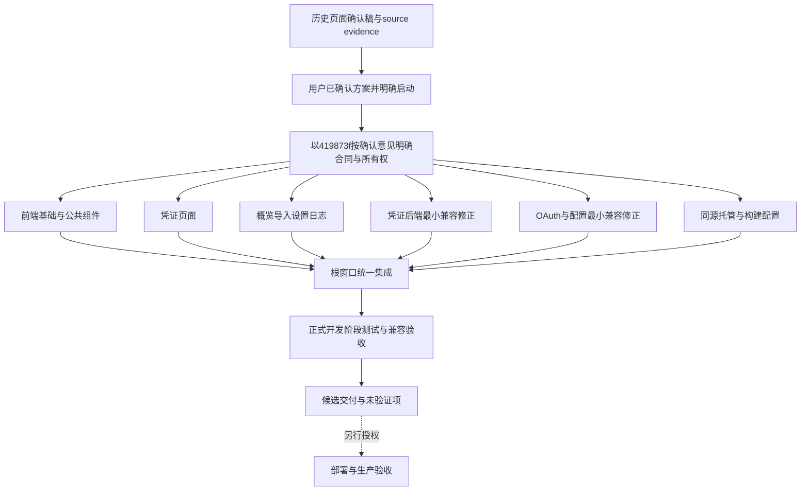

# gcli2api 新 UI 完整开发方案

日期：2026-10-13（Asia/Shanghai）。用户在主聊天明确表示“页面确认 OK，请继续”，当前状态为**用户页面确认通过，转入本地交付收尾**。确认依据是用户本次明确指令；历史 Review、实现及测试保留各自时点，不补造外部客户签字、默认入口替换或发布批准。颜色、字体与最终风格后置，旧接口与旧面板保持，生产发布门禁仍未通过。

本方案由方案窗口编写，根窗口统一更新与集成；方案窗口的文件所有权仅限本文件。主集成工作区为 `C:/Users/lywx2/.codex/worktrees/ui-redesign/gcli2api`，分支 `codex/ui-redesign`；共同开发基线为 `d1012` / `ebda92be2a4a5562963360bdbab2d33379e63077`。本文件的独立工作区为 `C:/Users/lywx2/.codex/worktrees/ui-development-plan/gcli2api`；此前文档分支 `codex/ui-development-plan` 及其审阅包提交保留。此前正式收尾从 `419873f` 建立 `codex/ui-formal-plan`；本次在独立工作区无未提交改动的前提下，从主集成已提交 `7a1d3841a5a50717b8312480a58b76afc2263716` 创建 `codex/ui-page-confirmed`，仅更新本文件。主工作树新出现的模型路由 DEV 草稿来源待根核对，不读取为本轮候选、不修改或纳入此次文档提交。只交付本地文档提交，不改主工作树。

## 独立 Review 结论与收敛

在 `7a1d384` 的 Review 收敛时点，交付定位为“本地候选交付（客户页面确认中）”，裁决为“方案质量有条件通过、本地候选交付有条件通过、生产发布就绪不通过”。2026-10-13 用户随后在主聊天明确页面确认通过并要求继续，该页面确认条件已满足；Review 的历史技术发现、测试限制和生产发布不通过结论保留。用户页面确认不等同于外部客户签字、默认入口替换授权或发布批准。

Review 所引用的 `419873f` 为历史时点；本次核查的产品源码已推进至 `e27698edd1de992cfb6269d1d367961ce42baf60`。发现状态按实际提交纠正，不回退已完成修正，也不把旧失败原文改写成当时通过。

| 发现 | 当前事实与处置 | 门禁结论 |
| --- | --- | --- |
| F03 未提交测试草稿 | `test_ui_hosting.py` 的 web 导入隔离与 `MODEL_MATRIX_VALIDATION.md` 已在 `d6905a0fa620be03dd3d79d5028e364a69e6e4de` 提交，核查时两文件均无未提交差异；同一提交含共享矩阵 fixture 修正，无产品模型 runtime 改动 | 指定草稿阻断已解除，不重复制造测试提交；文档收敛另作本地提交，候选记录须与提交对应 |
| F04 设置离站保护 | `1e87074`、`e27698e` 已加入 dirty/未确认写入的离站保护及取消后焦点处理；beforeunload 原生弹窗受浏览器策略控制，不能承诺任何环境都弹窗 | 不再作为“缺少实现”的当前阻断；保留默认入口替换前的完整交互/跨浏览器验收 |
| F05 邮箱任务引导 | 导入页明确提供“旧 AG 面板：手动获取邮箱与高级工具”，目标 `/#antigravity-manage`，页内测试有目标地址断言；旧高级功能继续由旧面板承接 | 文案/入口缺口已处置；不宣称新页已原生实现手动补全或全部高级功能 |
| F06 字段错误关联 | settings ConfigField 及专用 token 控件已有 aria-describedby、aria-invalid 与对应帮助/错误 ID；修正在上述设置提交中 | 不再描述为完全缺失；完整键盘、缩放、屏幕阅读器矩阵仍未验完 |
| F01 镜像与 Node 22 | engines 已校准，本机 Node 24.19.0 检查不能代替 Node 22 容器实跑；真实 Docker 镜像不可构建，仍未验证 | 未来发布另行启动的必要门禁，不阻断已授权本地文档收敛 |
| F02 旧模型矩阵 | 原始两版本各 253 失败/29 通过的记录仅为基线 fixture 缺陷隔离证据，不是通过证据；正式修正后独立重跑 282 通过、共享组合 407 通过，二者必须与原始记录分开 | 不能再断言当前仍有同组 253 失败；也不能据局部矩阵称全仓通过。未来发布须确定并完成候选版本所需完整兼容回归，发现产品问题另按维护范围处理 |

未来发布另行启动的必要门禁包括：F01 的真实镜像构建与 Node 22 容器验证；F02 所涉兼容回归范围完整性及候选版本结果；经单独明确授权的真实 OAuth/模型等外部联调；跨浏览器、键盘、缩放与 a11y 矩阵。当前均不据本地合成结果推定完成。这里列出门禁不授权立即外部调用、部署或全仓修复，不恢复 Gemini CLI 专属维护、cancelled MGMT、管理协议改造或对 manager 的 handoff。Management schema 1.4、panel-version.txt 保持不变。


## 1. 决策、范围与权威依据

采用 React + TypeScript + Vite + Tailwind CSS + shadcn/ui，配合 TanStack Table、React Hook Form 与 Zod。借鉴 CLIProxyAPI 管理中心的导航、任务分区、差异预览和状态反馈，沿用本项目的 API、认证及业务语义。源码按页面与功能模块拆分，五个页面分别 lazy 加载；不接受单文件页面全集、单 HTML 打包或所有业务代码塞入 App。配色、字体和最终视觉风格后置，只使用可替换语义 tokens。

首版增加 `/ui/` 并保留全部旧入口，面向 Antigravity 及必要共享面板功能。它不是中央 manager 新版本，也不是全量替换旧控制面板。Gemini CLI 专属功能继续留在旧入口，不恢复其维护；MGMT-009、MGMT-010、MGMT-012 的 cancelled 工作保持终止。Management schema 保持 **1.4**，Management capability 不变；下文新增能力只属于面板 `panel_capabilities`。manager 无需配套动作，记录 `no_counterpart_action`，不投递要求对端执行的 handoff。

此前用户授权的本地并行实施与开发阶段验证已执行并保留证据；本次按用户页面确认通过的最新指令进行本地交付收尾，不据历史执行包扩大开发或测试。用户最新指定本次 UI 子聊天使用 GPT-6.1 SOL（`gpt-6.1-sol`）、推理强度 Ultra；此前 AGENTS 的 Astra 要求保留为历史约束，本次遵循用户明确覆盖。方案窗口只更新本文，无产品源码新增，无需重跑已通过的应用测试。排除部署、推送、生产访问、真实 OAuth/模型调用、真实凭证/数据库/Volume 修改、迁移、凭证轮换、Claude 审核及默认根入口切换。原 checkout `G:/code/gemini30/gcli2api` 的用户改动和历史分支不得编辑、reset 或切换。提交保留 `.githooks/pre-commit`，对生成版本号的提示选择否，`panel-version.txt` 不变。

依据及优先级：

1. 本轮用户授权、`AGENTS.md`、[维护范围](../MAINTENANCE_SCOPE.md) 与 [终止记录](../delivery/MGMT-009-development-termination.md)。本轮 UI 基线已核实并记录为 d1012，不启动历史管理路线图。
2. 按顺序阅读的 [协作规范](../multi-repo/COORDINATION_SPEC.md)、[实施路线图](../multi-repo/IMPLEMENTATION_ROADMAP.md)、[Management 契约](../multi-repo/MANAGEMENT_API_CONTRACT.md)、[节点实施指南](../multi-repo/GCLI2API_CODEX_GUIDE.md)、[自动交接](../multi-repo/AUTOMATED_HANDOFF.md)，仅作为兼容约束，不恢复其取消项。
3. [开发评估](../UI_REDESIGN_ASSESSMENT.md)、[前端合同](FRONTEND_CONTRACT.md)、[并行边界](PARALLEL_DEVELOPMENT.md)、[静态部署说明](../UI_STATIC_DEPLOYMENT.md)。共享签名及文件所有权以合同为准，根窗口裁定合同变动。
4. 主集成工作区真实源码、提交及根窗口验证报告。文档中的旧占位路由描述须结合其窗口/时间理解；本方案不依据它宣称主分支仍未接线。

## 2. 当前候选确认与此前正式开发记录

2026-10-13 用户在主聊天明确“页面确认 OK，请继续”，页面确认已通过，后续仅转为本地交付收尾。当前方案基线为已提交 `7a1d384`；下述正式开发和测试仍是其原时点的技术证据，本次确认不改变测试数字，也不推定发布批准。

现行五页确认材料位于 `C:/Users/lywx2/.codex/visualizations/2026/10/13/01a132fa-9639-7c50-a301-b42ba28f74ee/`：目录 `customer-confirmation-current/` 与可转发包 `gcli2api-ui-confirmation-20261013.zip`。两处已核实存在，作为本次用户页面确认的现行材料。旧 `customer-review/`、`gcli2api-ui-customer-review.zip` 及旧截图只保留历史时点，不再作为现行确认包。

用户已确认当前方案并明确启动正式开发与开发阶段测试，五页结构、导航、主要流程、移动布局及旧入口保留作为本轮实施依据。历史页面确认材料基于 `fe99b43`，原样保留；本轮正式源从 `419873f` 开始，最终产品源码时点为 `e27698e`。设置离站保护/字段错误关联、Node engines、共享测试隔离、凭证抽屉反馈/焦点已完成并集成；259项前端、740项相关Python联合回归及本地构建/合成浏览器已通过。配色和最终风格后置，Docker/真实外部服务/完整跨浏览器门禁保持未验证，不部署。

以下为此前实现和验证的历史记录；正式收尾结果在第 12 节按原提交时点单列。本次页面确认记录没有产品源码新增、不产生新的测试通过结论。

初次只读核实时主集成 HEAD 为 `040fa5d66dd390fdb2b494d40be52785106b66d8`，五页真实 lazy 接线等仍是未提交修改。最终证据更新时读取到主分支 HEAD `41acf286053f1f6c1357cbcbc976b779944fc6c5`；移动布局与 fixture 排除修正已合入，根窗口的 `docs/ui-redesign/DELIVERY.md` 已记录 215 项前端测试、加强后的生产隔离检查及最终 Chromium/ASGI 复验通过，根已保存其集成源码提交 `e5cdd3d`。以下来源 SHA 是可追溯依据；最终交付 SHA 和工作树状态以根交付为准，本方案不声称自己重新运行这些验证。

| 模块 | 已交付来源提交 | 主集成对应提交（本次核实） | 状态与剩余门禁 |
| --- | --- | --- | --- |
| foundation | `86027ac`、`88cfdd6`、`1d24989` | `bf0c8f7`、`963ba8b`、`c4fc2c7` | client/auth/组件/工程已合入；真实五页接线与加强检查器已完成根验证，根接线已保存为 `e5cdd3d` |
| backendCreds | `4e8f9e4` | `68f37a3` | 面板能力矩阵与结果真实性已合入；最终回归证据随根交付 |
| backendAuthConfig | `ca5bf0d` | `62df56d` | OAuth 隔离与配置 False/异常修正已合入；真实外部 OAuth 未测试且不属于本次验收 |
| deploy | `57f050b` | `010f001` | Python 托管、多阶段 Docker 与忽略规则已合入；实际 Docker 镜像未构建 |
| workflowsPages | `a97569b`、`50128ec` | `217d475`、`8b1c163` | overview/import/settings/logs 四页已合入；邮箱分页、WS auth probe 竞态补丁已合入 |
| credentialsPage | `7a6a70d` | `040fa5d` | 凭证页及移动补丁 `106448fb` 已集成；fixture 修正 `e1db18c` → `41acf286` 已集成，根全量复验通过 |
| design | 五张合成结构图 | 非生产源码 | 供结构评审；不作为真实 API、主题或无障碍通过证据 |
| 本方案 | 仅 `DEVELOPMENT_PLAN.md` | 已集成，根窗口统一更新 | 用户确认与正式并行开发状态已同步；历史验证不视为本轮正式验收 |

设计图所在目录：`C:/Users/lywx2/Documents/Codex/2026-10-13/gcli2api-ui-structure-preview/outputs/design`。最终视觉选择仍开放。

状态术语统一如下：**已实现**表示代码存在；**已集成**表示进入根工作区；**待验证**表示没有对应最终证据；**已验证**必须附运行环境、命令、结果和源码时点；**后续另行启动**不得自动变为本轮待办。缺少证据不写成失败，也不写成通过。

## 3. 产品结构与功能对照

导航采用一个响应式外壳：宽屏侧栏、窄屏可关闭的导航 Sheet、页头与主内容。五页 hash 为 `#/overview`、`#/credentials`、`#/import`、`#/settings`、`#/logs`，未知 hash 回到概览。页面标题、当前导航、主要操作和错误提示须保持一致，不能依赖颜色表达状态。新 UI 不产生 legacy manage-ready 消息。

| 页面/入口 | 首版任务与已落地实现 | 接口/组件 | 验收与保留边界 |
| --- | --- | --- | --- |
| 登录与导航 | 复用面板密码登录、内存回退、登出、跨窗口会话变化；独立登录页和受保护外壳 | `auth/login`；AuthProvider、LoginScreen、Sidebar、Header、AppShell | 登录失败不误注销新会话；会话变化关闭导航 Portal；旧入口链接不带秘密 |
| 概览 | 今日/近七日逻辑请求统计、模型家族和 RPM、凭证摘要；分区不可用可独立展示 | `creds/stats-today`、`stats-recent`、`stats-today-by-model`、`status`；Card、统计表、Skeleton | 只保留既有统计口径；缺失为 unknown/null，不能显示假 0；页面隐藏不发轮询，离页销毁 |
| AG 凭证列表 | 状态、等级、错误、额度组、权限版本/状态、备注、文件名/已保存邮箱搜索；服务端分页、跨页选择、全部匹配 | `creds/status?mode=antigravity`；TanStack Table、移动 Card、FiltersPanel | 能力撤回同步撤销相关参数/选择；搜索不触发邮箱补全；不声称当前页排序为全局排序 |
| AG 详情与动作 | 列表摘要、已保存错误、额度/权限/周期证据；启停、永久禁用、删除、备注、Credit；单项额度/模型测试/项目验证；批量额度 | action、batch-action、remark、errors、quota、test、verify-project、batch-refresh-cooldown；Sheet、AlertDialog、ResultView | 不读取完整凭证 JSON 供详情；上游结果与状态写回分开；删除/永久禁用/Credit/批量副作用明确确认 |
| 选中工具 | 选中 ZIP 下载、已保存邮箱复制及缺失计数 | download-selected、copy-emails；Blob+Response、Clipboard | 1–100 项，超过 100 禁用并说明；不是自动分批绕过上限；剪贴板拒绝不能显示已复制 |
| 添加凭证 | JSON/ZIP、多文件、单个/批量 refresh token、OAuth 自动回调/手动回调及项目选择续接；逐项结果、邮箱任务 | upload、upload-by-refresh-token、upload-by-refresh-token-batch、auth/start/callback/callback-url、email-enrichment | 413 资源预算与部分成功分开；取消仅停止等待/跟踪；真实换码须以后端修正为前置 |
| 设置 | 服务、访问安全、网络、保护/重试、AG、保活白名单字段；环境锁、差异对照、dirty 保存、专用管理 token 状态/操作 | config/get、save、management-token、storage-engine；RHF/Zod、表单、对照表 | 不回写 config 全文；敏感输入不回填；保存后读回不是 CAS；运行配置可能需重启，不自动重启 |
| 存储与模型路由 | 新页只读当前存储引擎，提供旧配置页的预览/切换入口；模型路由沿用独立编辑器 | 旧 `/#config`、`/model-routing` | 存储迁移/切换未搬入新页；保留旧模型路由全表校验、草稿与失败保存；不新增数据迁移 |
| 日志 | 单连接、连接状态、等级筛选、有限缓存、下载、显式清空、可停止/重连 | logs/stream、download、clear；LogViewer、stream hook | 纯文本；断线不保证无损补发；下载/清空只在显式动作发生 |
| Gemini CLI 与其他未迁移动作 | 保持旧控制面板入口和业务 | `/`、旧 hash、`/front/*` | 不恢复 GCLI 专属维护；不因新页可用删除旧入口 |

功能对照不能以“页面存在”结束。以下项目必须在最终交付说明中明确其归属，未补齐前不能宣称新 UI 与旧面板全功能等价：

- 当前凭证 adapter 已有复制已保存邮箱，但未见手动获取邮箱 `fetch-email` 端点接线（旧实现保留在 `src/panel/creds.py`、`front/common.js`）；导入任务结束/失效提示中的“到凭证页手动获取邮箱”需核对实际可达入口。根已将提示指向旧 AG 面板，并在凭证/导入页提供 `/#antigravity-manage` 高级工具入口；复制不作为补全。
- 当前凭证 adapter 覆盖单项 test 与批量额度；batch-test、手动获取邮箱与异常额度组人工解除继续由旧 AG 高级工具入口承接，本轮不迁入新页。不能把 batch-refresh-cooldown 当成批量模型测试或异常解除，必须保留清楚的旧入口及功能说明。
- 存储预览/切换和模型路由旧页入口是已确认的首版范围安排。完整迁入 React、独立短时会话、配置事务/CAS、WS 新认证、全站代理子路径、默认根入口切换均属后续另行启动。
- 新设置页非敏感草稿支持跨路由/重新认证保留；刷新或关闭仍会丢失内存。本轮已实现按 dirty/未确认提交状态保护整页离站、清除秘密后切页确认，以及稳定错误 ID、aria-describedby/aria-invalid 与错误定位；手机导航卸载后取消可恢复有效焦点。原生 beforeunload 弹窗取决于浏览器，当前只核验阻止状态，不引入秘密持久化。

## 4. 目录、组件、状态与传输架构

```text
frontend/
  package.json + package-lock.json       唯一依赖与锁文件
  vite.config.ts + tsconfig.json + components.json
  check-build.mjs                        全量 manifest/五页 chunk 检查
  src/main.tsx
  src/app/                              App、hash routes、LoadBoundary、测试配置
  src/auth/                             session、AuthProvider、LoginScreen
  src/api/client.ts                     唯一 HTTP/URL/Blob 传输入口
  src/domain/shared.ts                  真正跨页的最小类型与工具
  src/components/ui/                    shadcn Radix 基础源码
  src/components/layout/                导航、页头、外壳
  src/styles/globals.css                 Tailwind 与语义变量
  src/pages/overview/                   index、api、types、useOverview、统计组件与测试
  src/pages/credentials/                index、api、model、useCredentials、筛选/表格/详情/结果/确认与测试
  src/pages/import/                     index、api、types、hooks、components、fixtures 与测试
  src/pages/settings/                   index、api、types、hooks、ManagementToken 与测试
  src/pages/logs/                       index、api、stream、useLogStream、LogViewer 与测试
ui-dist/                               同版本构建产物，不作为源码提交
src/panel/ui.py                         动态 HTML 与受限 assets 托管
```

每页 `index.tsx` 默认导出无外部 props 的页面组件，App 只装配 auth、布局、lazy 与加载边界。业务 hooks、验证器、types、fixtures、测试留在页面目录；跨页不得直接 import 另一页面内部实现。不新建第二套 client、全局业务 store 或平行构建系统。当前 hash 外壳使用轻量 routes 模块；安装了 React Router 不代表必须为了依赖而重写已工作的路由。

状态分层：

| 层 | 保存内容 | 生命周期与约束 |
| --- | --- | --- |
| session | token、authenticated、sessionEpoch | 单一来源；代次变化同步通知清理；token 不是独立后端会话 |
| 页面读取 | 列表/统计/配置观察值/日志、能力集合 | 内存；会话代次+页面请求序号双重隔离；登出清除 |
| 选择/任务 | 显式 filename Set、筛选代次、进度、已确认结果 | 筛选/能力/会话变化失效；旧请求不得重建选择或恢复弹层 |
| 表单草稿 | 基线、dirty 字段、上次提交、读回观察值 | 按当前字段白名单保留草稿；密码与专用 token 输入清理。网络 URL 按配置字符串处理，不宣称自动识别或清除其所有内嵌秘密 |
| 临时 UI | Sheet/Dialog、焦点归还位置、loading、error | 页面/会话销毁时关闭，包含 body Portal；不能仅隐藏根 DOM |

共享 client 提供 `getServiceBase`、`createServiceUrl`、`requestJson`、`requestBlob`、`ApiError`；签名以合同为准。服务 base 来自 HTML 注入并校验同源；path 是 `creds/status` 这样的服务根相对路径，拒绝绝对 URL、`//`、根绝对路径、遍历和编码逃逸。filename 使用一次 `encodeURIComponent`，校验匹配后端一次解码，保留字面 `%` 与 Unicode。资源 base `./` 与 API service base 独立。

`mode=antigravity` 按真实端点声明放置：列表/动作 query，OAuth 和 refresh token 导入 body；不把 `AG` 当服务值。JSON 与 FormData 分开，浏览器决定 multipart boundary。Bearer 由 client 统一附加；认证重定向拒绝。Blob 返回 body 与 Response，保留下载计数等 header。非 2xx 抛带 status/payload 的 ApiError，但 UI 只使用白名单投影和安全消息；HTML/纯文本异常不反射。HTTP 200 的 success/errors/aggregate 由各 endpoint adapter 验证，空值不是成功。所有写操作和有副作用 GET 都不自动重试。

## 5. 会话、秘密与动作状态机

面板 login 返回 token 当前就是面板密码；前端 logout 是本地清理，不宣称服务端 token 撤销。持久化只沿用 `gcli2api_auth_token`，localStorage 失败回退内存，不新增秘密持久化。跨窗口 storage 事件只作为通知，重新读当前存储值，避免迟到事件覆盖新登录；读取存储失败不抹掉当前内存会话。

真实 panel-auth 401/403 与上游拒绝必须分开。当前 client 仅将 detail-only 且为既有面板依赖明确错误文本（`密码错误`、`Not authenticated`、`Invalid authentication credentials`）认作面板认证失败；带 `response_source`、`upstream_status` 或其他业务字段的额度拒绝及未知错误保持页面错误。登录失败只显示登录错误。若后端认证错误形状将来改变，需显式更新合同和测试，不能扩大成所有 401/403 退出。

login 成功、logout、真实认证失效、跨窗口 token 变化推进 sessionEpoch。每个读请求捕获 epoch 与页内 generation，响应头和 body 解析后均核对；AbortController 负责节省资源，代次检查才决定是否采纳。旧代 401/403 不得注销新代；同代失效幂等。会话变化清除列表、选择、秘密、OAuth 中间值、日志、轮询和所有 Portal。设置仅保留非敏感草稿并进入需重新读取状态，重新登录不重放写操作、不静默 GET 覆盖草稿。

| 动作结果 | 判断依据 | UI 及后续动作 |
| --- | --- | --- |
| success / acknowledged | 端点结构和应答数量/字段相符 | 展示已确认范围；按需要刷新观察值，不能承诺后续无并发变化 |
| rejected / failed | 明确拒绝或逐项失败 | 保留可修正输入及安全原因；用户改正后显式提交 |
| partial | 部分成功且可确认剩余失败/未确认 | 同时展示成功、失败与未确认；不重放成功项，不把绿色 Toast 当完整结果 |
| unknown | 超时、断线、5xx、标识/计数冲突、缺字段 | 提示可能已写入，保留非敏感证据，先读取观察；不将观察值伪造为原提交确认 |
| cancelled / stopped | 浏览器停止等待或不再调度后续批次 | 说明在途服务端动作可能完成；不宣称回滚、服务端取消或幂等重放安全 |

原始配置、完整凭证 JSON、refresh token、client secret、授权/回调 URL、state/code、WS token URL 不进入应用日志、Toast、截图、持久 store 或测试输出。配置 GET 旧形状仍可能含秘密，新 UI 必须在 adapter 白名单投影时丢弃；这不等于后端已完成通用脱敏 API 改造。下载选中凭证属于用户显式导出，不拿导出内容填详情或缓存。

## 6. 凭证查询、能力与人工检测

### 6.1 后端最小兼容修正

| 存储后端 | permanent_disabled | remark | credit_mode |
| --- | --- | --- | --- |
| SQLite | 支持 | 支持 | 支持 |
| PostgreSQL | 支持 | 支持 | 支持 |
| MongoDB | 不支持 | 支持 | 支持 |
| MySQL | 不支持 | 不支持 | 不支持 |
| 未知后端 | 不支持 | 不支持 | 不支持 |

完整名称分别为 `antigravity.credentials.permanent_disabled`、`antigravity.credentials.remark`、`antigravity.credentials.credit_mode`。依据为 `src/panel/credential_capabilities.py`，不是通过 UI 猜数据库品牌。保留既有 search、auto_email、cooldown.group_filter、model_access.family_filter 的真实存储条件；它们不在上表中被默认为所有后端支持。统计缺失独立降级，不借本轮统一不同存储的统计口径。

后端修正只涉及 AG 列表 permanent_disabled 投影、能力声明、unsupported 501、布尔 False/异常与批量计数真实性。不改 schema/存储迁移。单项动作、备注及不支持筛选使用既有 `detail/error_code/capability` 形状，`error_code=capability_unavailable`；批量仍可 HTTP 200 aggregate，在 errors 逐项记录，只有后端真成功才累计。credit 不支持时必须在副作用前拒绝，不能清除冷却后再报错。

前端按当次响应能力集合启用控件。缺失/类型错误/撤回都禁用，删除不支持的参数、取消物化选择及旧读；501 对应能力当前会话内降级，不把瞬时 503/504 当永久能力撤回。旧服务没有新能力字段时不猜支持。前后端测试必须同时有支持与不支持、False、partial、投影及拒绝不清冷却反例。

### 6.2 分页与选中范围

1. 列表使用服务端筛选与 offset/limit，filename 是稳定行标识，桌面表格和移动卡片共享同一选择状态。筛选变化清空选择并推进读取代次；普通刷新保留/处理选择须遵循 hook 当前语义，不能重新推断全局范围。
2. “选择当前页”只加入该页 filename；跨页显示实际已选数量。“读取并选择全部匹配”每次最多 1000 项分页，去重物化为 Set，展示进度并可取消；分页不前进、失败、筛选/能力/会话变化时停止，不能把半成集合提示为已选全部。
3. 全部匹配是多次观察，不是原子快照；读取期间新增/删除可能改变集合。最终写请求只提交显式 filename，不发送“全库”“当前筛选自动应用未来项”的隐式写范围。
4. 下载/复制限制为 1–100 项，前端按钮和 adapter 两层拦截；上限不限制其他已定义的批量动作。ZIP 显示 `X-Selected-Count`/`X-Missing-Count`，缺 header 显示未知；复制报告去重邮箱及匹配/缺失数。生成 object URL 后撤销，不长期保存 Blob。

### 6.3 手工检测与副作用

额度 GET 会访问上游、刷新 token、同步冷却/权限等状态，不能作为无害只读预取。打开详情、焦点、hover、列表刷新和概览轮询都不得自动调用。固定回复模型测试、项目验证也只从显式操作触发，显示可能的状态写回及统计影响；批量操作先确认数量/副作用。

结果同时展示面板 HTTP、上游 HTTP、回复校验与每项 state_update 的 applied/pending/skipped/failed/unknown。HTTP 200、上游调用成功和状态落库成功不合并为一个成功图标。额度组未知/异常不能展示为可用，人工异常解除与计时冷却独立，不扩大 Credit 为异常解除。

现有批量额度按 10 项顺序分组，停止只阻止后续组，在途组可完成。缺失/重复/意外 filename 或结果数量冲突即 unknown 并停止后续组，保留之前确认的结果。面板 endpoint 不继承 Management API 的幂等保证；未知时先观察，不能自动重放。

## 7. 导入、OAuth 与邮箱任务

上传和 refresh token 的 UI 校验只改善输入体验，后端仍是格式、ZIP 条目/总解压量、写并发和存储成功的权威。413 显示资源预算限制；逐项成功/失败/unknown、warnings、邮箱任务分开呈现。不能将收到 HTTP 200、拿到 job_id 或客户端进度条走完等同于全部落库成功。

OAuth 后端在 `src/auth.py` 及 `src/panel/auth.py` 保持现有外部 endpoint/shape，实施：

- `secrets.token_urlsafe(32)` opaque state，禁止拼面板密码；服务端用 HMAC 派生 owner，flow 中不保存原 token。
- 同 owner+mode 仅一个活动 flow；选择流程同时验证 state、owner、mode、TTL（当前 600 秒）和回调绑定。旧 flow、跨 mode、跨 owner、重复参数及错误端口不能落入新 flow。
- provider 本地 callback handler 校验本 flow/端口；手工 callback-url 严格检查回调来源/绑定和必要唯一参数，不信任任意粘贴 URL。
- completion lock 串行化换码、项目选择与保存；换码结果不能因重复点击并发消费。同一 flow 的项目选择可续接，不用新 flow 偷换语义。
- TTL 在进入持久化前检查；已获准的单次持久化保持锁直到完成，不能在第一个 await 后被新 flow/清理替换而重复存储。过期/失败/完成清理 map 和 callback server；限制内存数量，区分正在持久化的 flow。
- 同步/异步路径共用选择和清理规则；移除授权 URL、code/token 片段、state、会话、callback URL 与敏感异常回显，不能仅依赖日志正则补救。

owner 是共享面板密码派生的所有者标识，不是独立用户账户；进程内 map/lock 不提供多 worker 分布式会话保证。真实 Google OAuth、网络端口与部署可达性此次未调用。合成测试通过仅证明隔离逻辑，不证明外部服务流程可用。

前端按 auth/start、callback/callback-url 的 body 传 `mode=antigravity`；授权链接校验 HTTPS Google accounts 来源。state/code/URL 仅在当前流程内存持有，会话变化清理；失败不自动换码重试。项目选择响应需要用户明确选择/填写再继续。取消显示“停止等待，服务端可能已保存”，而不是“已撤销授权”。

邮箱补全使用本地构造的 `creds/email-enrichment/{jobId}`，不访问响应中的任意 status_url。当前 adapter 每页 100、最多 50 页/5000 项，校验 job_id、total、items 长度及状态；按完整分页观察判断 complete+sealed，早页仍有 queued/running/settlement_pending 时不能因末页 terminal 宣告完成。显示 success/failed/skipped/superseded/unknown，404 表示过期或重启后失效并停止轮询。新导入推进任务代次，旧任务不覆盖新结果；离页、登出、停止跟踪清除计时器，不宣称服务器任务被取消。

## 8. 设置、日志与统计的精确语义

### 8.1 设置

GET 建立已知字段基线、env_locked、config capabilities 与 management-token 安全状态。表单仅纳入 `pages/settings/types.ts` 白名单；秘密字段从不回填，密码和可能含秘密的网络/保活 URL 在差异表中隐藏。dirty patch 只含改动且未锁定、有能力的字段，不回传 config 原文。未改秘密省略；明确空串不是“保持原值”，当前新密码控件拒绝空新值和全星号掩码，不把占位符提交给后端。

后端 save 遇到 set_config 明确 False 或异常不得报成功；逐键写入仍可能部分成功，没有事务回滚与 CAS。前端区分 acknowledged/partial/rejected/unknown，保留非敏感原基线、草稿、最近提交和当前观察。未知或部分确认后必须先主动重新读取；GET 只是观察，不证明本次提交最终状态或不存在他人覆盖。采用观察值、放弃草稿须显式触发，不静默重置。修改面板密码后的确认或未知结果需清理旧登录并重新认证，不自动用新密码重试。

management token 使用专用 PUT/DELETE，与模型 API 密码和面板 token 分开，展示 configured/locked/source 等状态，操作有确认且遵守环境锁。UI 有此功能不代表本次开发可对生产轮换。存储引擎仅显示当前观察值和旧入口，旧页的预览、备份/覆盖确认不在新页伪造。policy_digest 属于模型路由策略摘要，不能作为配置版本或 CAS token。

### 8.2 日志

登录且停留在日志页才建立一个 WS，StrictMode 的探测挂载应可在连接前清理。使用统一 service URL 并把协议映射为 ws/wss；沿用 `/logs/stream?token=...`，不记录连接 URL，不暗改为服务端不支持的 header 认证。卸载、登出、代次变化关闭 socket，清理计时器和 auth probe，旧 socket 事件不得更新新页面。

当前边界：最多 1000 行、256000 字符、单行 8192 字符截断；仅文本渲染，不能解释 HTML。最多 5 次退避重连（1/2/4/8/16 秒）；正常关闭/明确拒绝停下，超限显示手动操作。浏览器不可见 WS handshake HTTP 状态，1006 可调用受保护只读端点核对登录，probe 有 5 秒上限且取消后迟到结果无效。probe/重连都不能无限循环。

重连可能重复初始尾部或遗漏断线期间内容，现有协议无 cursor/resume 保证。筛选与暂停视图不创造持久日志保证。服务器清空、日志下载由用户显式触发；清空响应做业务校验，失败保留当前显示和可恢复提示。

### 8.3 统计

概览复用已有 logical_requests 口径，展示获取失败、后端不支持和数据缺失；不把未知计数转换为 0。当前轮询 30 秒，隐藏页面不请求，刷新/会话/离页销毁旧循环。只读取统计和列表摘要，不通过刷新统计触发额度/模型调用；不增加终身累计或跨后端口径统一工程。

## 9. 正式实施分工与候选交付记录

下表保留此前已授权工作及其收尾证据；本次评审收敛不重新启动这些执行包。

用户已明确启动正式并行开发与开发阶段测试。下表保留六窗口文件所有权；本轮只对明确的收尾项安排改动，不重做已存在实现。设计窗口保留历史确认材料，颜色/字体/最终风格后置；根窗口统一协调实现、测试与最终证据，不等待 Docker 环境恢复才推进其他已授权工作。

| 窗口 | 独占文件范围 | 可并行工作 | 交付给根窗口 |
| --- | --- | --- | --- |
| foundation | frontend 工程配置/lock、main、app、auth、api/client、domain/shared、components/ui/layout、styles、公共测试配置 | 与后端/托管并行；页面按稳定合同开发 | 共享接口、组件清单、依赖锁、会话/URL 测试；共享修正由此 owner 或根统一合并 |
| credentialsPage | `frontend/src/pages/credentials/**` | 与四页/两个后端并行 | 列表、选择、动作、详情、fixtures、页内测试；移动布局补丁仅本目录 |
| workflowsPages | `frontend/src/pages/{overview,import,settings,logs}/**` | 各页内部可拆模块，不能另改共享工程 | 四页入口/adapter/hooks/测试，OAuth/config 失败处理、WS 生命周期 |
| backendCreds | `src/panel/creds.py`、`credential_capabilities.py` 及对应测试 | 与 auth/config 和前端并行 | 能力矩阵、501、False/partial、投影及副作用反例 |
| backendAuthConfig | `src/auth.py`、`src/panel/auth.py`、`config_routes.py` 及对应测试 | 与 creds/托管并行 | OAuth owner/state/mode/TTL/完成锁、日志、配置失败语义 |
| deploy | Dockerfile、忽略规则、panel/root、panel/ui、必要 web 接线及托管测试/说明 | 与 foundation 协调两个 HTML 注入点和 outDir 后并行 | Python `/ui/`、assets、旧入口兼容、镜像构建定义与部署/回滚说明 |

设计窗口只交独立合成结构图，不改生产源码；本方案窗口只交本文件。根窗口唯一负责跨窗口冲突、路由装配、合同变更、最终检查及交付结论。不要因为本工作区缺另一个窗口文件就复制临时实现或重新安装依赖。



| 执行包 | 前置与可并行性 | 可审阅产出与退出条件 | 当前状态 |
| --- | --- | --- | --- |
| UI-C 页面确认 | 2026-10-13 用户在主聊天明确“页面确认 OK，请继续” | 现行 `customer-confirmation-current/` 与 `gcli2api-ui-confirmation-20261013.zip`；旧包仅历史，不补造外部签字/反馈 | 页面确认通过；后续转入本地交付收尾 |
| UI-P0 本轮基线与所有权 | UI-C；统一从主集成 `419873f` 开始，先检查状态 | 复用干净 checkout 建 `codex/ui-formal-*`；脏树保留草稿，必要时新建管理 worktree；共享文件唯一 owner | 已明确；各窗口保留自己已有草稿 |
| UI-P1 工程/托管 | P0；foundation 与 deploy 可并行 | Node engines 真实交集与锁/构建配置对齐；纳入并审阅托管测试缓存草稿，检查测试隔离和旧入口 | Node engines `84de8fc`、托管测试隔离 `d6905a0` 已交付；相关Python联合740项通过，Docker实际未验 |
| UI-P2 后端兼容边界 | P0；复用已交付最小修正 | 本轮不改模型 runtime 或 Management schema/capability；共享矩阵只修隔离 fixture，不弱化断言 | 原修正历史证据保留；共享 fixture `d6905a0` 已交付，正式隔离结果见第 12 节 |
| UI-P3 页面收尾 | P0/P1 共享合同；与工具链/测试工作并行 | settings 离站保护、表单错误关联，以及凭证抽屉动作反馈和刷新后关闭焦点恢复；五页及旧高级入口保持，颜色字体后置 | 设置与凭证补丁已集成；局部与最终前端259项、合成浏览器专项通过 |
| UI-P4 根集成 | 各收尾包来源提交、范围与局部证据齐全 | 逐提交集成，解决共享文件冲突；不修改用户原 checkout，不复制旧分支共享实现 | 已按来源提交统一合入，产品源码时点e27698e，原checkout用户改动保留 |
| UI-P5 开发阶段验证 | 本轮同一候选源码、实际 Node 与产物 | 相关隔离单元/接口/Legacy回归、构建/五页manifest/fixture检查及浏览器验证；保留原矩阵与修正后证据区别 | 已完成相关本地检查：前端 259 项、Python 联合 740 项、生产构建/隔离及合成 Chromium；完整 Docker/跨浏览器矩阵未验 |
| UI-P6 本地候选交付 | P5 的实际证据、最终 SHA、已知限制 | 候选说明、兼容影响与回滚；版本/钩子不变；Docker 未验明确列出 | 用户页面确认已通过，当前进行本地交付文档/提交收尾；保留原验证时点及未验门禁，不推送、不部署 |
| UI-P7 后续发布 | 用户另行明确启动并确认范围 | 实际镜像与生产计划、默认入口决定和发布门禁 | 未启动，不自动继续 |

本轮正式收尾包在上述所有权内并行执行；以下仅记录实际已报告的提交/结果，其他项目保留待验证：

| 收尾项 | Owner 与修改边界 | 依赖与验收目标 | 当前结论 |
| --- | --- | --- | --- |
| UI-F1 settings 离站与错误关联 | workflowsPages 的 `frontend/src/pages/settings/**`；共享导航若确需变更由 foundation/根接线 | 有 dirty 时整页离开给可取消保护，无 dirty 不多余阻拦；取消保留草稿；密码/token 不增加持久化；字段错误可关联、可定位，环境锁保持 | 已集成 `f732755` + `15c23d2` → `1e87074` + `e27698e`；局部 35 项及最终合成浏览器通过，秘密未知提交提醒和移动取消焦点已补齐 |
| UI-F2 Node engines 真实交集 | 根明确委派 deploy 修改 package/lock 根 engines 元数据与构建说明，不升级依赖 | 核实所有锁定依赖要求的真实交集，校准项目声明及构建版本；验证实际本机 Node 的安装/类型/构建/产物，不仅比较单个包或宽泛主版本 | 已集成 `0723e8d` → `84de8fc`；133 个锁依赖的 Node engines 在本机 24.19.0 满足，npm ci/typecheck/build/check:build 通过；未升级依赖，Docker 实跑未验 |
| UI-F3 共享模型矩阵 fixture 隔离 | 根指定的测试 owner，仅既有共享模型矩阵测试 fixture；不改 router/API/model runtime/config 业务实现 | 每例内存路由 adapter 与配置/环境隔离，测试后恢复；保持原参数、断言和错误期望，无 skip/xfail；原始基线证据和正式修正后结果分别记录 | 已提交 `d6905a0`；原 282 项正式重跑 282 通过，共享 routing 125 通过，组合 407 通过并验证环境恢复；产品模型 runtime 不变 |
| UI-F4 托管测试缓存草稿 | deploy/根指定托管测试 owner，审阅既有托管测试缓存隔离草稿；不覆盖他人未提交修改 | 纳入必要的缓存/配置状态隔离及恢复，确认重复或组合运行不互相污染；保留无真实 lifespan、无生产数据的测试边界和原托管/旧入口断言 | 已纳入 `d6905a0` 的 `test_ui_hosting.py` 隔离修改；不据此声称 Docker 或根最终前端集成复验通过 |
| UI-F5 凭证抽屉反馈与焦点 | credentialsPage，仅 `frontend/src/pages/credentials/**` | 在抽屉内可见且可读地展示动作反馈；列表刷新后关闭抽屉恢复到有效触发点或合理替代点，不落到 Body；不改 API/动作语义，配套合成行为验证 | 已集成 `85011df` → `87134ba`；局部 116 项，桌面/手机反馈及有效行焦点复验通过；删除后的标题 fallback 由单元测试覆盖 |
| UI-F6 根集成与文档 | 根合并 F1–F5 并更新最终证据；本方案窗口只改本文件 | 来源 SHA、相关命令/实际结果、历史与新增证据、未验项清晰；按影响执行集成检查，不把 Docker 不可用扩大为全体停止 | 已统一集成 F1–F5；前端259/24文件、Python联合740、10JS+1CSS/五独立页/0fixture产物、合成浏览器及真实产物ASGI通过；Docker未验 |

F1、F2、F3、F4、F5 按所有权并行；F6 的最终结论依赖实际合入后的同一源码和产物。F2/F4 的 Docker 相关限制仅阻断真实容器验证及发布就绪判断，不阻断本地开发、静态检查、实际 Node 本机验证或其他隔离测试。

不以天数代替依赖门禁，不从旧 issue/handoff 恢复工作。所有后续补丁注明 owner、来源 SHA、改动接口与相关复验；相同文件冲突由根处理，不让多个窗口互相覆盖。已通过检查只有代码变化或新发现关联时才重复，移动样式补丁仍需重跑相关页面/构建与浏览器布局检查。

## 10. 响应式、键盘和异常状态

首版结构先验收，再接最终主题。当前合成 Chromium 已报告 1440 与 390 宽度无横向溢出，原移动首屏统计/筛选较长，`106448fb` 已折叠调整；根报告首张卡片可见及折叠草稿复验通过，最终截图仍须绑定最终候选。

| 场景 | 可执行验收 |
| --- | --- |
| 宽屏/中屏/手机 | 1920、1440、1024、390；内容区域不横向溢出，必要表格在局部滚动；移动卡片与桌面表格共享选择，不双份状态 |
| 缩放和长内容 | 125%/200% 缩放、长 filename/email/错误文本、中文与 Unicode；允许浏览器缩放，不裁掉确认/取消按钮；详情可读全标识 |
| 键盘 | Tab/Shift+Tab 顺序、Enter/Space 操作、Escape 关闭、焦点圈可见；Dialog/Sheet 焦点受限且关闭回触发器；登出 Portal 消失 |
| 表单 | label 对应 input，错误与字段通过 aria 关联，首个错误可定位；dirty/环境锁/能力缺失有可读说明；不能只用颜色区分 |
| 异步反馈 | loading、空库、无匹配、读取失败、partial、unknown、权限失效、501、断线、过期任务均有不同文本；busy 防重复提交，读失败可手动重试 |
| 路由/chunk | 五页首次访问按需获取 JS；错误边界给显式刷新并提示内存草稿；不自动 reload 或循环重载 |
| 动作选择 | 确认内容包含目标数量和副作用；筛选/会话变化使旧确认失效；隐藏/禁用控件在键盘路径上行为一致 |
| 日志/统计 | 状态变化有适度 aria-live；大量日志不持续抢焦点/朗读；未知统计不可装作正常 0 |

这些为验收条件，不是全部已通过的结论。Firefox/WebKit、真实屏幕阅读器、完整缩放与键盘矩阵若未运行，逐项记录未验证。设置错误关联、离开提醒已在本轮补齐并做专项核验；复用 Radix 并不能替代页面组合后的检查。

## 11. 主题接入与构建托管

### 11.1 主题后置

foundation 统一维护 background、foreground、card、muted、border、primary、destructive、ring 等 CSS 变量，字体通过 `--font-interface`；业务需 success/warning/info 时先定义语义再选值。页面不写品牌色、任意 hex 或固定字体，状态文字/图标独立于颜色。未来主题工作只需集中改变量、组件 variants 和必要的密度/字号规则，再对五页截图、对比度、focus、暗色候选与移动布局复验。当前 neutral 是基础配置，不是用户确认的最终设计；设计图不锁定风格。

### 11.2 构建与完整产物

Node 仅用于构建，运行时为 Python。使用同一 checkout 的 manifest 和唯一 lockfile，Node 范围以 `frontend/package.json` engines 为准（Docker 构建阶段为 Node 22；此前工程声明最低 22.12，但历史锁依赖核查要求至少 22.22.2 / 24.15.0；UI-F2 已通过 `84de8fc` 将声明校准为 `^22.22.2 || ^24.15.0 || >=26.0.0`，133 个锁依赖的 engines 在实际 Node 24.19.0 上满足；不据此宣称每个允许版本均实跑）；不为本文件升级依赖。命令从仓库根执行：

```sh
npm --prefix frontend ci
npm --prefix frontend run typecheck
npm --prefix frontend test
npm --prefix frontend run build
npm --prefix frontend run check:build
```

Vite `base='./'`、`outDir='../ui-dist'`、manifest 开启。检查器必须验证：五个 `src/pages/<name>/index.tsx` 都是 isDynamicEntry 且文件各不相同；每个 manifest entry 的 file/css/assets 在产物内真实存在；每个 imports/dynamicImports 引用存在；JS/CSS 带 hash；HTML 资源相对寻址且两个注入点存在；没有内联 bootstrap/单文件产物；生产即使设置 `VITE_UI_FIXTURES=true` 也不含 DEV fixture。浏览器还要验证实际按需加载，不能只数 JS 文件。

本次产物审阅曾发现凭证 fixture 顶层合成数据虽在生产分支不执行，仍残留于 chunk；这是生产隔离检查不足，不是真实数据泄漏。现已改为 DEV 双条件动态 import，并通过更强检查：公共哨兵、页面业务合成标识和 manifest fixture 模块均为 0。加强后的门禁曾明确拒绝反例产物，修正后通过；不能只证明开关为 false。

fixture 条件严格为 `import.meta.env.DEV && import.meta.env.VITE_UI_FIXTURES === 'true'`。使用合成 example.invalid、虚构 filename 和内存状态，未知 fixture 路由失败关闭，不落回真实后端；真实 API 失败不落回合成成功。开发服务器仅 loopback，不以启动真实 `web.py` 代替隔离验证。

### 11.3 Python 同源托管

- `/ui` 返回保留 query 的 307 到 `/ui/`；hash 由浏览器保留/处理，应用内部使用 hash 路由。v1 正式范围是根部署。
- Python 动态读取 index，替换 `gcli-service-base` / `gcli-embed-policy` meta 占位符，使用 HTML 属性转义；HTML `Cache-Control: no-store`，沿用既有 CSP `frame-ancestors`。不能用裸静态 index 绕过策略注入。
- 只挂载 `/ui/assets`，JS/CSS MIME 正确并设 nosniff，hash 资源一年 immutable，非 hash no-cache；缺资源 404，不返回 HTML fallback。不静态公开 index 或 `.vite/manifest.json`。
- 缺 index/assets、非法 UTF-8 或缺注入点时新入口返回 no-store 503 及旧入口链接；应用导入/旧入口仍可用。构建应在应用导入前完成；进程启动后才加 assets 需重启。
- service_base 只读取可信 ASGI root_path，不信任 X-Forwarded-Prefix。标准 root_path 的隔离测试不等于全站子路径支持；前端还拒绝不合规/百分号编码 service base。不要承诺 OAuth、旧页和任意 Unicode/编码前缀全部可用；正式子路径部署须另行完整验证。
- 旧 `/`、`/#manage`、`/front/*`、`/model-routing` 及其 embed/CSP/ready 契约保持；AG 新页不能冒充 legacy manage ready。没有 SSO、跨域 token 注入或 manager 代理改造。

### 11.4 Docker 与上下文

Docker ui-build 阶段执行 npm ci、typecheck、build、check:build，再将匹配源码的完整 ui-dist 复制至 Python 最终阶段；无需 Node 常驻或另设静态服务。`.dockerignore` 排除根运行 creds/credentials/data、数据库、私钥、env、Git、node_modules、虚拟环境和本地产物，必须保留业务 `frontend/src/pages/credentials` 及源码 data 目录。JSON 采用精确放行前端工程/锁与已知非敏感协议文件，不开放任意凭证 JSON；`.gitignore` 同样精确处理工程文件。自定义真实数据始终在构建上下文之外，不作 build argument。

可选 Moby patternmatcher 的历史上下文检查不能代替 Docker build。当前本地交付收尾阶段 Docker 环境仍不可构建，不启动引擎、不安装绕行，完整镜像与 Node 22 容器实跑继续标为未验证；已有静态/Node 本机结果保留原时点。本次页面确认不解除该门禁，待环境和后续验证范围另行明确后补验，不因此推定发布就绪。现有 Actions 触发器保持，不借此恢复发布。

## 12. 历史证据与本轮正式验证门禁

本方案窗口仅更新文档并做文档检查，不运行应用测试、不访问真实服务。下表保留 `419873f` 所含历史源码/交付证据，其中 215 项前端等数字均不是本轮 UI-F1–F5 的新通过结果。本轮正式新增结果已由根按实际运行更新如下表，命令、数字、源码时点及限制详见 DELIVERY 与本机 `formal-closeout/`；不得用预览结果或已撤回 fixture 实验替代。各组存在重叠，禁止相加制造更大覆盖数字。

根本轮已报告的正式进展如下；方案窗口只读核实提交内容并记录报告，未自行执行这些测试。各测试组有包含关系，282 与 125 的组合为 407，不能再把 407 加入前两项形成新的独立覆盖总数。

| 正式收尾项 | 来源/根提交 | 已报告结果与限制 |
| --- | --- | --- |
| 共享矩阵与托管测试隔离 | `d6905a0fa620be03dd3d79d5028e364a69e6e4de` | 原 282 项整组 282 通过；共享 routing 125 通过；组合 407 通过，fixture 环境恢复。原 253 失败未由 UI 引入，本轮仅修测试初始化/隔离，产品模型 runtime 不变 |
| Node engines | 来源 `0723e8d` → 根 `84de8fc3e338596fde2be16503d7ed01e8f75f66` | 133 个锁依赖的 engines 在 Node 24.19.0 满足；npm ci、typecheck、build、check:build 通过；未升级依赖，真实 Docker 仍未验证 |
| settings 离站保护与 ARIA | `1e87074` + `e27698e` | 已完成；局部35项、最终259项前端和1440/390专项浏览器通过；beforeunload原生弹窗不保证 |
| 凭证抽屉反馈与关闭焦点 | `87134ba` | 已完成；局部116项、最终259项前端、1440/390反馈及有效行焦点通过；行消失后的标题fallback由单元测试覆盖 |
| 根最终前端集成复验 | `e27698e` | 新跑259项/24文件、typecheck/build/check:build、10 hashed JS+1 CSS/五页/0DEV数据、五页及设置/凭证专项浏览器、真实产物ASGI通过；Python联合740项通过 |

| 历史证据 | 已记录结果 | 来源/限制 |
| --- | --- | --- |
| foundation/credentials 局部测试 | 源目录 README 曾记录 66 foundation、86 credentials；credentials 合计 152 | 只作各窗口局部历史记录；不能加到根 215 上，旧 placeholder 构建不算五页验收 |
| 根完整前端 | 21 文件、215 项通过；typecheck、生产 build、加强 check:build 通过 | 最终 DELIVERY 及根报告；本地 Node 24.19.0，仅合成响应 |
| 根产物 | 8 个 hashed JS、1 个 CSS；五页独立 dynamic entry、完整 manifest/资源引用、0 fixture 模块、0 公共及业务合成数据标记通过 | 最终 DELIVERY；生产显式设置 `VITE_UI_FIXTURES=true` 同样通过；反例曾被加强门禁拒绝 |
| Python 集成 | 两组分别 261、114 项通过，含 42 项重叠 | 根报告；不能称 375 个不同测试，不把 mocked backend 当真实四引擎生产验证 |
| 旧面板 Node | 68 项通过 | 根报告；与某窗口先前 29 项历史记录不累加 |
| 旧模型 API 独立矩阵 | 原始 ebda92b 与 fe99b43 各 282 项均为 253 失败、29 通过；全部用例结果及失败内容指纹一致，0 差异 | 干净 Git archive、同一隔离 runner 完整对比，确认这组失败未由 UI 引入；原矩阵仍未通过；本轮 UI-F3 正式修正和新增通过结果见上表；保留此原始失败记录，不把它改写成当时已通过。见 [完整归因记录](MODEL_MATRIX_VALIDATION.md)，不恢复 GCLI/MGMT 开发 |
| 合成 Chromium | 五页导航、导入 partial、跨路由非敏感 settings 草稿及合成保存、详情/跨窗口登出重登、移动导航登出通过；1440/390 无横向溢出；无外部/真实 API 请求、无 pageerror | 最终 `UI_SMOKE.json` 及截图；移动首屏第一张卡可见，折叠保留筛选草稿；最终复验通过，不扩大为全部键盘/浏览器验证 |
| 生产产物内存 ASGI | 真实 index+五页 chunks 的 no-store/meta/CSP、MIME/immutable、index/manifest/缺资源 404、带 query 307 通过 | 最终 `UI_HOSTING_SMOKE.json` 再验通过；不启动真实 lifespan，不等同真实镜像运行 |
| Docker 上下文/实构建 | Moby 原生规则检查 17 保留和 14 排除路径通过；完整镜像未验证 | daemon 不可用；Node 22 容器版本仅检查 engines/lockfile/接线，不把本地 Node 24 验证等同容器运行 |
| 跨浏览器/完整可访问性 | 未冻结或未验证 | Chromium 上述场景以外，不宣称 Firefox/WebKit、全键盘、200% 缩放、屏幕阅读器通过 |
| 真实外部服务/生产 | 未执行 | 本轮范围排除真实 OAuth、模型、数据库/凭证、生产 API 与部署，不作为本地测试的隐含步骤 |

最终报告目录已由根交付记录为 `C:/Users/lywx2/.codex/visualizations/2026/10/13/01a132fa-9639-7c50-a301-b42ba28f74ee`，包含 `UI_SMOKE.json`、`UI_HOSTING_SMOKE.json`、`ui-smoke.py`、`ui-hosting-smoke.py` 与 `runtime-*.png`。这是本机证据路径，不是可移植构建依赖。根交付继续负责绑定其最终集成 SHA；本方案不替根写最终测试结论，也不把未运行门禁补作通过。

必要行为检查与关联资产：

| 检查包 | 输入/失败注入 | 必须证明的结果 |
| --- | --- | --- |
| client/auth（frontend app/auth 测试） | 真实 panel-auth 与上游 401/403、body 延迟、并发登录、storage 延迟/不可用、跳转/编码路径 | 只使正确代次失效，无跨源 Bearer，无旧代更新，无写重试 |
| credentials（页内测试 + `test_panel_credential_capabilities.py`） | 四种后端及 unknown、501/撤回、False/partial、全匹配中止、101 项工具、结果标识冲突 | 能力真实、显式 filenames、上限、取消不回滚、unknown 不重放、unsupported credit 无清冷却 |
| auth/config（`test_oauth_flow_isolation.py`、`test_panel_config_save_failures.py`） | state/owner/mode/TTL/端口错配、并发完成/替换/保存中清理、False/异常/部分写 | 不串 flow/不重复换码、敏感日志不回显、失败不伪成功，无事务承诺 |
| workflow 页内测试 | 413、部分导入、未知结果、项目选择、邮箱分页/404、env lock/秘密草稿、WS 1006/probe 延迟 | 状态真实、轮询有生命周期、草稿保留、秘密清除、单 WS/有限重试 |
| hosting/Legacy | `test_ui_hosting.py`、`test_panel_embed.py`、`test_model_routing_panel.py`、`test_frontend_static.py`、`test_panel_state.cjs` | 缺产物旧入口可用、动态 CSP、静态隔离与缓存、旧 hash/ready/模型路由不回归 |
| Management | `test_management_api.py`、`test_management_openapi.py` | schema 1.4/capability/动作语义不变，无新增对端任务 |
| 集成浏览器 | 合成登录→导入→筛选/选择→动作→设置→日志→登出；未知/partial/501/chunk404；手机/键盘 | 真五页接线、结果文案和焦点正确、fixture 无外部请求、补丁后无新回归 |

最终本地验收退出条件：来源提交和根修改全部可定位；五页与共享文件 ownership 无越界；相关回归/构建/产物/浏览器证据对应最终候选；已知功能缺口有准确旧入口或限制说明；未验证门禁逐项列明；panel-version 与 hook 保持；没有真实数据/秘密进入 diff、测试或产物。未完成 Docker/跨浏览器门禁及旧模型 API 原始矩阵结果必须随本地候选披露，不能称发布就绪。原矩阵在记录的 ebda92b 与 fe99b43 对照中已完成全量归因；本轮只恢复已明确授权的共享 fixture 隔离及开发阶段验证，不改模型 runtime、不恢复 GCLI/MGMT 工作。本轮共享 fixture 修正已有独立正式通过记录；设置与凭证补丁及根最终前端集成结果已按本轮实际运行更新，明细见 DELIVERY 和 `formal-closeout/summary.json`；不能引用历史临时实验代替。

## 13. 风险、回滚与交付

| 风险 | 控制与残余限制 | 回滚/恢复 |
| --- | --- | --- |
| 升级后旧页请求旧 hash chunk | 明确刷新提示并提醒内存草稿；不循环 reload；不承诺跨镜像保留旧 assets | 回到旧面板或刷新匹配新版；需要版本回退则整镜像恢复 |
| token 等同密码、localStorage 与 WS query | 最小复用协议、秘密不出日志/URL 展示、会话代次清理；不声称解决 XSS 或服务端会话撤销 | 登出清本地；独立 session/WS 认证调整以后另启 |
| 配置/动作网络失败后结果未知 | 保留安全证据并重新观察，不自动重试，不承诺事务/幂等 | 显式对照当前状态；UI 回滚不撤销已写入值 |
| 不同存储能力与未知统计 | 声明矩阵+动态能力门控+501；不给 unsupported 造成功 | 旧入口继续可用；不能靠换 UI 修复底层未支持语义 |
| 全匹配期间集合变化 | 明确多页观察及最终 filename 集合；筛选/会话变化停止 | 放弃选择后重新读取，不能假设快照稳定 |
| OAuth 单进程/共享 owner | state 隔离、TTL/锁/清理已实现；多 worker/真实回调尚未验证 | 过期流程重新显式开始；不盲目重放未知换码/写入 |
| 静态上下文含真实数据 | 精确忽略、synthetic context 测试、真实数据在上下文外 | 阻止镜像交付；若误包含则另行处理，不在本任务旋转凭证 |
| 页面迁移未等价/移动密度 | 功能对照、旧入口、合成浏览器检查；移动补丁复验 | 单页退回旧入口，保留后端兼容修正 |
| 主工作区持续变化 | 最终 SHA 和证据绑定；文档快照不抢占当前改动 | 根选择可审阅提交集；不 reset 用户 checkout |

回滚单位是**同一版本 Python + HTML + 完整 assets 的镜像/源码产物集合**，不能只复制 index 或只撤一半静态文件。旧 `/` 始终可用，新产物缺失只使 `/ui/` 返回 503。本次没有数据库迁移，不需要新 schema 回退；任何已经成功的导入、删除、配置写入或外部动作不会被 UI/镜像回滚撤销。回滚实际部署仍需另行授权。

本地交付清单：最终分支/SHA、仅相关文件的变更说明、各 owner 来源与根集成提交、schema/capability/manager 影响、实际命令/测试结果、浏览器/产物报告路径、功能保留清单、未验证门禁、风险与回滚。方案聊天仅提交本文件并交出绝对路径；根窗口集成它，不要求用户人工复制交接块。不得推送、部署或触发历史 MGMT handoff。

未来发布另行启动后，至少补齐：Docker daemon 下完整镜像构建及容器同源冒烟；最终候选的浏览器/键盘/缩放与功能对照；已知缺口处置；固定版本与 revision、完整旧镜像可恢复；明确生产验收允许哪些只读/副作用动作及目标；确认是否继续保持 `/ui/` 试用或切换默认入口。真实 OAuth/模型验证如果需要，须单独限定范围；不能由本方案自动扩展授权。全站代理子路径、跨镜像旧 chunk 留存、原子配置/CAS、主题定稿等也不自动成为发布前已实现能力。
